part 1

1 - in the first case for ls /usr/sh first tab autocompleted sh into share, second tab wanted to show all 329 possiblities of autocompletion after /share
for cd/et one tab autocompleted into etc

2 - ctrl+r allows autocomplete for previous comands. i did cd/kynex, cd lab3, so when i do cd k it autocompletes into kynex, cd (blank) autocompleted lab3 since it was the most recent command
it then runs the command on enter

4 - 1. cd and echo are shell built in. cd must be builtin to navigate the internal os system

3. command not found
exit code 127

4. ls -t 
sort by time, newest first

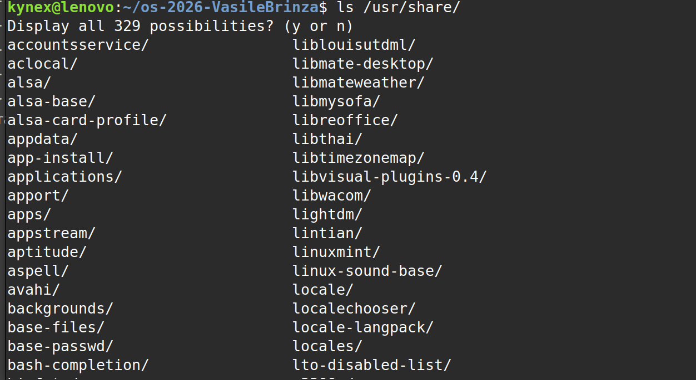

part 2:

predict:
command - my prediction - actual result - explanation
echo *.c - output all files ending in .c - same - star autofills output
echo file?.txt - files1.txt and files 2.txt - same - ? is a free character
echo[a-b]* - all files containing a to b - a.c alfa beta.txt b.c
echo *.xyz - *.xyz - *.xyz - no .xyz files in our dir, it just outputs the same message
ls alfa beta.txt - ls: cannot access 'alfa': No such file or directory
ls: cannot access 'beta.txt': No such file or directory
- i did not expect this output, since beta.txt exists 

ls "alfa beta.txt" - 'alfa beta.txt' - i understand now, that it knows to search for "alfa" and "beta" files, while alfa beta no marks

echo '$HOME' "$HOME" /$HOME - $HOME /home/kynex //home/kynex - its the difference between actual echo, path echo, and real path ehco

kynex@lenovo:~/os-2026-VasileBrinza/lab3/play$ echo {1..5} ; 
1 2 3 4 5
kynex@lenovo:~/os-2026-VasileBrinza/lab3/play$ echo $((7 * 6))
42
kynex@lenovo:~/os-2026-VasileBrinza/lab3/play$ 

different brackets allow computations using echo, where they output the result rather than the actual input

kynex@lenovo:~/os-2026-VasileBrinza/lab3/play$ echo "today is $(date +%A), I am $(whoami)"
today is Monday, I am kynex
kynex@lenovo:~/os-2026-VasileBrinza/lab3/play$ 

$ within quotes allows computations

kynex@lenovo:~/os-2026-VasileBrinza/lab3/play$ touch log{1..3}.txt && ls log*
log1.txt  log2.txt  log3.txt

we create 3 differnt log files, as {1..3} allows for dynamic creation, to avoid repeation

questions:

2. before echo runs, * autocompletes all posibilities, which is why it prints all file names
3. ls alfa beta.txt fails because it interpets as 2 different files

to fix --

Use quotation marks:
bash

ls "alfa beta.txt"

Escape the space with a backslash:
bash

ls alfa\ beta.txt
kynex@lenovo:~/os-2026-VasileBrinza/lab3/play$ ls alfa\ beta.txt
'alfa beta.txt'

4. difference between single and double quotes is that single are interpreted literally
while double quotes interprets variables

ls shows alfa beta.txt with quotes because to differentiate as a single file, not as 2 seperate

![figure 2.4]](image-6.png)

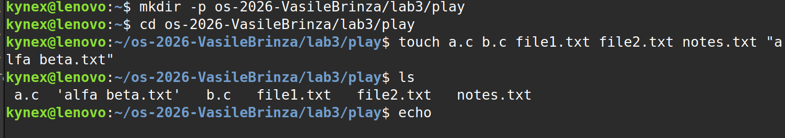

![figure 2.2]](image-7.png)

part 3

kynex@lenovo:~/os-2026-VasileBrinza/lab3/play$ ls /etc /nope
ls: cannot access '/nope': No such file or directory
/etc:
adduser.conf            gai.conf           lvm                  rmt
adjtime                 gdb                machine-id           rpc

/nope does not exist
/etc outputs all of the directories there

using > out.txt 2> err.txt

redirects output into out.txt
and errors - that /nope doesn't exist - into err.txt

kynex@lenovo:~/os-2026-VasileBrinza/lab3/play$ wc -l out.txt ; cat err.txt
259 out.txt
ls: cannot access '/nope': No such file or directory

wc -l out.txt → reports 259 lines in out.txt. These lines contain the listing of /etc.

where wc reports word count, -l in number of lines

cat err.txt → displays the error message because /nope does not exist.

; → runs the second command after the first one finishes, regardless of whether the first succeeds.

kynex@lenovo:~/os-2026-VasileBrinza/lab3/play$ ls /etc /nope > all.txt 2>&1 ; tail -2 all.txt
zsh
zsh_command_not_found
kynex@lenovo:~/os-2026-VasileBrinza/lab3/play$ 

it outputted zsh correctly since those are the last two lines in all.txt

echo first > notes.md writes first into notes.md (from the play directory

)

kynex@lenovo:~/os-2026-VasileBrinza/lab3/play$ echo first > notes.md
kynex@lenovo:~/os-2026-VasileBrinza/lab3/play$ cat notes.md
first
kynex@lenovo:~/os-2026-VasileBrinza/lab3/play$ echo second >> notes.md
kynex@lenovo:~/os-2026-VasileBrinza/lab3/play$ cat notes.md
first
second
kynex@lenovo:~/os-2026-VasileBrinza/lab3/play$ 

kynex@lenovo:~/os-2026-VasileBrinza/lab3$ ls /nope 2> /dev/null | echo "failed with code $?"
failed with code 0
kynex@lenovo:~/os-2026-VasileBrinza/lab3$ 

kynex@lenovo:~/os-2026-VasileBrinza/lab3$ mkdir -p tmp && cd tmp && echo "I am in $(pwd)" ; cd lab3
I am in /home/kynex/os-2026-VasileBrinza/lab3/tmp
 
 kynex@lenovo:~/os-2026-VasileBrinza/lab3/tmp$ sleep 100 &
[1] 23418

runs sleep in the background and tells you the job number [1] and pid - process id

kynex@lenovo:~/os-2026-VasileBrinza/lab3/tmp$ jobs ; kill %1 ; jobs
[1]+  Running                 sleep 100 &
[1]+  Running                 sleep 100 &
kynex@lenovo:~/os-2026-VasileBrinza/lab3/tmp$ kill %1
bash: kill: (23418) - No such process
[1]+  Terminated              sleep 100
kynex@lenovo:~/os-2026-VasileBrinza/lab3/tmp$ jobs ; kill %1 ; jobs
bash: kill: %1: no such job

Command
	

Explanation

jobs
	

Lists background jobs managed by the current shell.

kill %1
	

Sends a termination signal to job number 1.

jobs after termination
	

The job may briefly appear before Bash updates its status.

kill %1 again
	

Fails because the process or job has already terminated

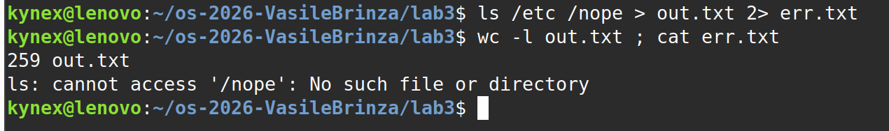\

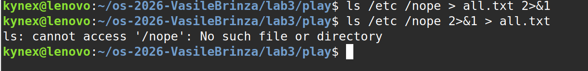

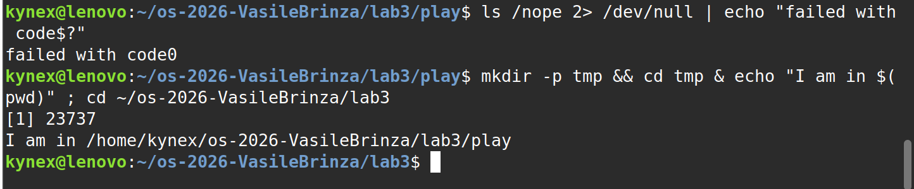

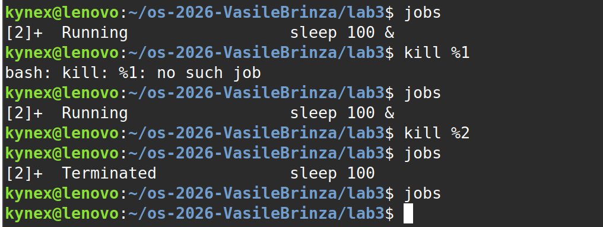

part 4

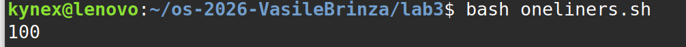

grep searches for lines containing FAIL. The option -c counts how many lines match. Therefore, 100 requests failed.

cut -d' ' -f5 access.log | sort -u

Explanation:

    cut -d' ' -f5 extracts the fifth field, which contains the page.

    | sends the output to the next command.

    sort sorts the page names alphabetically.

    -u removes duplicates.

There are 4 different pages: /page0, /page1, /page2, and /page3.

cut -d' ' -f5 access.log | sort | uniq -c

Explanation:

    cut extracts the page field.

    sort groups identical page names together.

    uniq -c counts consecutive identical lines.

Each page received 125 requests. The total is 125×4=500125×4=500 requests.

Command:
bash

grep FAIL access.log | cut -d' ' -f3 | sort | uniq -c | sort -rn | awk 'NR==1{m=$1} $1==m{print $2, $1}'

Explanation:

    grep FAIL selects failed requests.

    cut -d' ' -f3 extracts the username.

    sort groups usernames together.

    uniq -c counts failures per user.

    sort -rn sorts counts from largest to smallest.

    awk prints the users whose failure count equals the maximum.

Result: user5 and user3 are tied, with 15 failed requests each.

Command:
bash

printf "Total: "; grep -c ' user3 ' access.log; printf "Failed: "; grep FAIL access.log | grep -c ' user3 '

Explanation:

    printf prints a label.

    grep -c ' user3 ' counts all requests made by user3.

    grep FAIL selects failed requests.

    The second grep -c ' user3 ' counts only the failed requests belonging to user3.

Result: user3 made 72 requests, of which 15 failed.

Command:
bash

grep FAIL access.log | tail -3 | cut -d' ' -f2,3

Explanation:

    grep FAIL selects failed requests.

    tail -3 takes the last three matching lines.

    cut -d' ' -f2,3 extracts only the time and username.

Result: The output contains the times and users for the last three failed requests in the log.

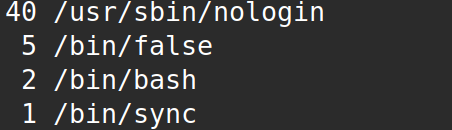

Command:
bash

cut -d: -f7 /etc/passwd | sort | uniq -c | sort -rn

Explanation:

    cut -d: -f7 extracts field 7 from /etc/passwd, using : as the separator. This field contains each account's configured login shell.

    sort groups identical shells together.

    uniq -c counts accounts using each shell.

    sort -rn sorts the counts from largest to smallest.

Results:

    /usr/sbin/nologin — 40 accounts; generally accounts that should not have interactive login access.

    /bin/false — 5 accounts; a shell setting that immediately exits, preventing a normal login session.

    /bin/bash — 2 accounts; accounts configured to use Bash.

    /bin/sync — 1 account; a shell setting that runs the sync command.

These numbers describe the accounts on your Linux system, so they can differ between computers.
Q8

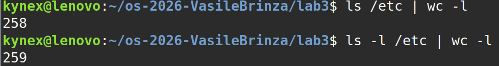

Explanation:

    ls /etc lists directory entries, one per line when piped.

    ls -l /etc displays detailed information and adds a total line at the beginning.

    wc -l counts the lines it receives.

Therefore, the second command normally produces a result one greater than the first because of the additional total line.

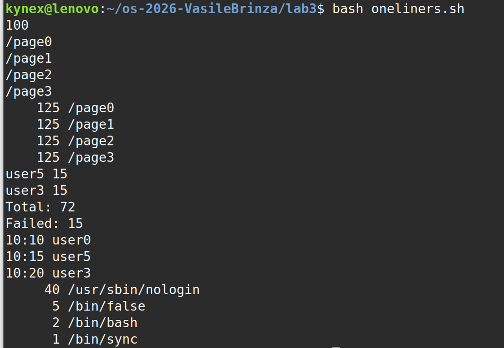

all questions

bonus:

kynex@lenovo:~/os-2026-VasileBrinza/lab3$ grep -E ' 10:[0-5]0 .* FAIL ' access.log
2026-10-05 10:10 user3 FAIL /page2
2026-10-05 10:20 user6 FAIL /page0
2026-10-05 10:30 user2 FAIL /page2
2026-10-05 10:40 user5 FAIL /page0
2026-10-05 10:50 user1 FAIL /page2
2026-10-05 10:00 user4 FAIL /page0
2026-10-05 10:10 user0 FAIL /page2
2026-10-05 10:20 user3 FAIL /page0
2026-10-05 10:30 user6 FAIL /page2
2026-10-05 10:40 user2 FAIL /page0
2026-10-05 10:50 user5 FAIL /page2
2026-10-05 10:00 user1 FAIL /page0
2026-10-05 10:10 user4 FAIL /page2
2026-10-05 10:20 user0 FAIL /page0
2026-10-05 10:30 user3 FAIL /page2
2026-10-05 10:40 user6 FAIL /page0
2026-10-05 10:50 user2 FAIL /page2
2026-10-05 10:00 user5 FAIL /page0
2026-10-05 10:10 user1 FAIL /page2
2026-10-05 10:20 user4 FAIL /page0
2026-10-05 10:30 user0 FAIL /page2
2026-10-05 10:40 user3 FAIL /page0
2026-10-05 10:50 user6 FAIL /page2
2026-10-05 10:00 user2 FAIL /page0
2026-10-05 10:10 user5 FAIL /page2
2026-10-05 10:20 user1 FAIL /page0
2026-10-05 10:30 user4 FAIL /page2
2026-10-05 10:40 user0 FAIL /page0
2026-10-05 10:50 user3 FAIL /page2
2026-10-05 10:00 user6 FAIL /page0
2026-10-05 10:10 user2 FAIL /page2
2026-10-05 10:20 user5 FAIL /page0
2026-10-05 10:30 user1 FAIL /page2
2026-10-05 10:40 user4 FAIL /page0
2026-10-05 10:50 user0 FAIL /page2
2026-10-05 10:00 user3 FAIL /page0
2026-10-05 10:10 user6 FAIL /page2
2026-10-05 10:20 user2 FAIL /page0
2026-10-05 10:30 user5 FAIL /page2
2026-10-05 10:40 user1 FAIL /page0
2026-10-05 10:50 user4 FAIL /page2
2026-10-05 10:00 user0 FAIL /page0
2026-10-05 10:10 user3 FAIL /page2
2026-10-05 10:20 user6 FAIL /page0
2026-10-05 10:30 user2 FAIL /page2
2026-10-05 10:40 user5 FAIL /page0
2026-10-05 10:50 user1 FAIL /page2
2026-10-05 10:00 user4 FAIL /page0
2026-10-05 10:10 user0 FAIL /page2
2026-10-05 10:20 user3 FAIL /page0
kynex@lenovo:~/os-2026-VasileBrinza/lab3$ grep -Ec ' 10:[0-5]0 .* FAIL ' access.log
50

Explanation for your report: The grep -E command searches for failed requests where the minute ends in zero (00, 10, 20, 30, 40, or 50). The -c option counts the matching lines. In the generated log, there are 50 matching failed requests.

part 5

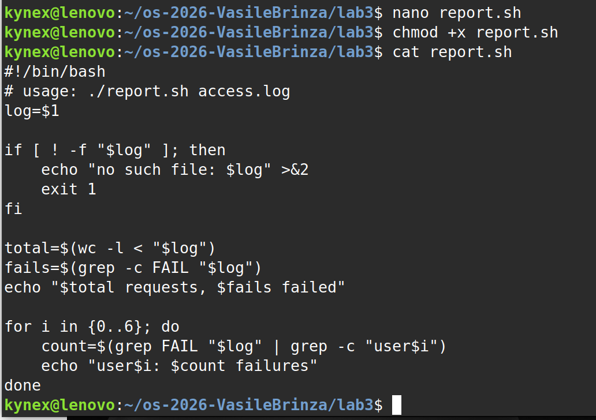

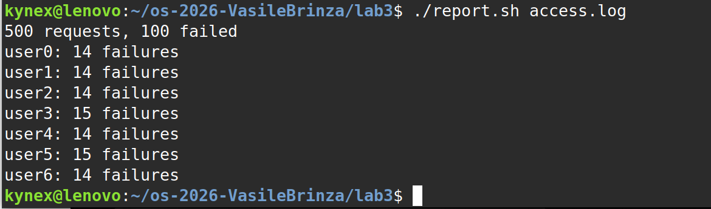

./report.sh access.log
500 requests, 100 failed
user0: 14 failures
user1: 14 failures
user2: 14 failures
user3: 15 failures
user4: 14 failures
user5: 15 failures
user6: 14 failures

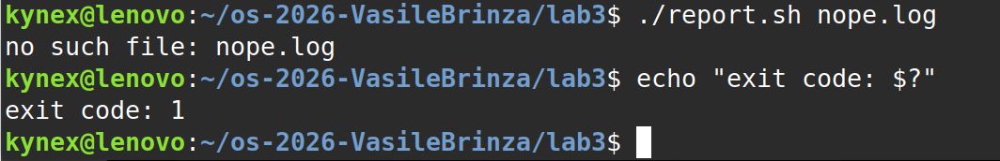

missing file

kynex@lenovo:~/os-2026-VasileBrinza/lab3$ ./report.sh nope.log
no such file: nope.log
kynex@lenovo:~/os-2026-VasileBrinza/lab3$ echo "exit code: $?"
exit code: 1
kynex@lenovo:~/os-2026-VasileBrinza/lab3$ 

Step 5 — Write these answers in your report (2 minutes)

1. What does #!/bin/bash do? What happens before chmod +x?

The first line tells the operating system to run the script using Bash. Before adding execute permission, running ./report.sh normally fails with a permission-denied error.

2. Why type ./report.sh instead of report.sh?

./ tells the shell to execute the script in the current directory. The current directory usually isn't included in the PATH variable.

3. Why use >&2 and exit 1?

>&2 sends the error message to standard error instead of normal output. exit 1 terminates the script with a nonzero status to indicate failure.

Conclusion: The script accepts a filename, counts total and failed requests, reports failures per user, and handles a missing file correctly.

Important: Your instructions also mention putting report.sh inside the repository's lab3/ folder. After testing, make sure the final script is saved there with your Word report and oneliners.sh.
